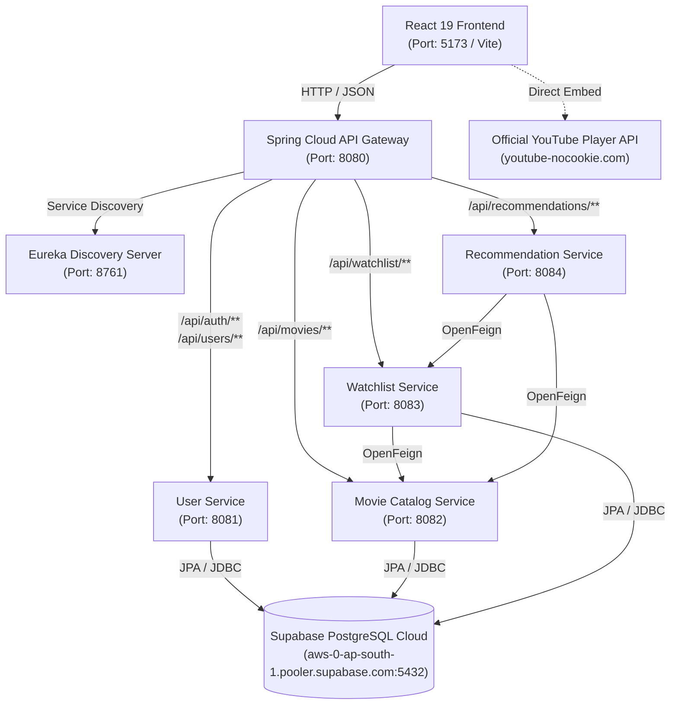

# StreamFlix — Java Full Stack Movie Trailer Streaming Platform

> **A modern, responsive, copyright-safe movie trailer discovery and viewing platform built with Java, Spring Boot 3, Microservices Architecture, and React 19.**

StreamFlix delivers the sleek visual experience of premier streaming platforms while strictly adhering to copyright compliance by streaming **official movie trailers, teasers, and promotional videos only** via authorized YouTube IFrame Player embeds.

---

## Architecture Overview

StreamFlix is designed with an enterprise-grade Microservices Architecture orchestrated by Netflix Eureka Service Discovery and Spring Cloud Gateway.



### Microservice Responsibilities

| Service | Port | Responsibilities |
|---|---|---|
| **Eureka Server** | `8761` | Central service registry and dynamic service discovery. |
| **API Gateway** | `8080` | Central entry point, route dispatching, centralized CORS, JWT validation, and RBAC role header propagation (`X-User-Id`, `X-User-Role`). |
| **User Service** | `8081` | User registration, authentication, BCrypt password hashing, JWT token issuance, and profile management connected to Supabase PostgreSQL. |
| **Movie Catalog Service** | `8082` | Movie metadata CRUD, search, pagination, Telugu & Hindi trailers, and strict Copyright-Safe trailer URL verification in Supabase PostgreSQL. |
| **Watchlist Service** | `8083` | User personal watchlists, duplicate prevention, and OpenFeign catalog enrichment connected to Supabase PostgreSQL. |
| **Recommendation Service** | `8084` | Genre-based preference algorithm analyzing user watchlist history via OpenFeign with fallback to top-rated releases. |
| **Frontend** | `5173` | React 19 SPA, Tailwind CSS, Lucide icons, responsive dark cinematic UI, trailer modal player, and Admin control panel. |

---

## Copyright Compliance Policy

- **Trailers Only**: StreamFlix strictly catalogs official promotional trailers and teasers. Full movie hosting, streaming, torrenting, or unauthorized caching is strictly prohibited and architecturally blocked.
- **Authorized Embeds**: All trailers are embedded using the official YouTube IFrame Player API using the privacy-enhanced `youtube-nocookie.com` domain.
- **Backend Validation**: The `TrailerValidator` enforces strict 11-character YouTube ID patterns (`^[a-zA-Z0-9_-]{11}$`) and rejects unauthorized external video sources.
- **Rights Disclaimer**: Movie titles, poster artworks, backdrops, and video assets belong to their respective copyright holders (Warner Bros., Universal, Paramount, Marvel, Sony, etc.).

---

## Directory Structure

```
streamflix/
├── .env                          # Active environment configuration
├── .env.example                  # Environment configuration template
├── docker-compose.yml            # Multi-container orchestration (MySQL + 6 services + Frontend)
├── README.md                     # Complete project documentation
├── streamflix_postman_collection.json # Ready-to-import Postman API collection
├── frontend/                     # React 19 + Vite + Tailwind CSS Application
│   ├── Dockerfile
│   ├── nginx.conf
│   ├── package.json
│   ├── vite.config.js
│   ├── index.html
│   └── src/
│       ├── components/           # HeroBanner, MovieCard, MovieCarousel, TrailerPlayerModal, Navbar, Footer...
│       ├── context/              # AuthContext, WatchlistContext, TrailerModalContext
│       ├── data/                 # Seed blockbuster movie catalog with verified YouTube IDs
│       ├── pages/                # Home, Browse, MovieDetails, Watchlist, Profile, AdminDashboard, Login, Register...
│       └── services/api.js       # Axios client with JWT interceptor & resilient fallback
└── backend/                      # Java Spring Boot Microservices
    ├── pom.xml                   # Maven Parent / Aggregator POM
    ├── docker/init-db.sql        # MySQL multi-database initialization script
    ├── eureka-server/            # Netflix Eureka Service Discovery (Port: 8761)
    ├── api-gateway/              # Spring Cloud Reactive Gateway + JWT Security (Port: 8080)
    ├── user-service/             # Auth & Profile Microservice (Port: 8081)
    ├── movie-catalog-service/    # Movie Metadata & Search Microservice (Port: 8082)
    ├── watchlist-service/        # Personal Watchlist Microservice (Port: 8083)
    └── recommendation-service/   # Genre-based Recommendation Microservice (Port: 8084)
```

---

## Test Accounts & Quick-Login

The system seeds default accounts automatically upon startup. On the web frontend Login page, you can use the **1-Click Fill** buttons or enter:

| Role | Username / Identifier | Password | Access Rights |
|---|---|---|---|
| **Administrator** | `admin` (or `admin@streamflix.com`) | `Admin@123` | Full access + Admin Dashboard (Add, Edit, Delete trailers, Live Preview). |
| **Demo User** | `john_doe` (or `john@streamflix.com`) | `User@123` | Browse, watch trailers, personal watchlist, and profile management. |

---

## Quick Start Guide

### Option 1: Run with Docker Compose (Recommended)

To launch the full stack (MySQL database, Eureka Server, API Gateway, 4 microservices, and React frontend) with a single command:

```bash
docker-compose up --build
```

Access the services:
- **Frontend UI**: [http://localhost:5173](http://localhost:5173)
- **API Gateway**: [http://localhost:8080](http://localhost:8080)
- **Eureka Dashboard**: [http://localhost:8761](http://localhost:8761)

---

### Option 2: Running Locally for Development

#### 1. Start the React Frontend

```bash
cd frontend
npm install
npm run dev
```
The frontend starts at [http://localhost:5173](http://localhost:5173). It contains a built-in mock fallback with 16 blockbuster trailers, allowing full UI exploration immediately even before backend microservices finish compiling!

#### 2. Supabase PostgreSQL Cloud Database
StreamFlix is configured to use your **Supabase PostgreSQL Session Pooler**:
- **Host**: `aws-0-ap-south-1.pooler.supabase.com`
- **Port**: `5432`
- **Database**: `postgres`
- **User**: `postgres.ermxmicincezjacgfdhy`
- **Password**: `Coco100.com`
- **JDBC Connection String**: `jdbc:postgresql://aws-0-ap-south-1.pooler.supabase.com:5432/postgres?sslmode=require`

All tables (`users`, `movies`, `watchlist`) and 28 verified trailers (including Telugu and Hindi cinema) are already initialized in Supabase.

#### 3. Build & Run Backend Microservices

In `backend/`, build the parent project:
```bash
mvn clean package -DskipTests
```

Start the services in the following order:
1. **Eureka Server**: `java -jar eureka-server/target/eureka-server-1.0.0-SNAPSHOT.jar` (Port 8761)
2. **User Service**: `java -jar user-service/target/user-service-1.0.0-SNAPSHOT.jar` (Port 8081)
3. **Movie Catalog Service**: `java -jar movie-catalog-service/target/movie-catalog-service-1.0.0-SNAPSHOT.jar` (Port 8082)
4. **Watchlist Service**: `java -jar watchlist-service/target/watchlist-service-1.0.0-SNAPSHOT.jar` (Port 8083)
5. **Recommendation Service**: `java -jar recommendation-service/target/recommendation-service-1.0.0-SNAPSHOT.jar` (Port 8084)
6. **API Gateway**: `java -jar api-gateway/target/api-gateway-1.0.0-SNAPSHOT.jar` (Port 8080)

---

## REST API Reference

All requests route through the **API Gateway** on port `8080`.

### 1. Authentication (`/api/auth`)
- `POST /api/auth/register` — Register a new account (`username`, `email`, `password`, `role`).
- `POST /api/auth/login` — Login and receive a JWT token (`usernameOrEmail`, `password`).

### 2. User Profile (`/api/users`)
- `GET /api/users/me` — Retrieve current authenticated user profile (Header: `Authorization: Bearer <token>`).
- `PUT /api/users/me` — Update username, email, or password.

### 3. Movie Catalog (`/api/movies`)
- `GET /api/movies` — Paginated catalog list (`page`, `size`, `sortBy`, `sortDir`, `genre`).
- `GET /api/movies/{id}` — Get single movie details with trailer embed link.
- `GET /api/movies/search?keyword={keyword}` — Search by title, director, or cast.
- `GET /api/movies/genre/{genre}` — Filter by genre.
- `GET /api/movies/trending` — Top-rated trending trailers.
- `GET /api/movies/featured` — Hero banner featured releases.
- `POST /api/movies` — **ADMIN ONLY**: Create new trailer record.
- `PUT /api/movies/{id}` — **ADMIN ONLY**: Update movie details.
- `DELETE /api/movies/{id}` — **ADMIN ONLY**: Delete movie trailer record.

### 4. Watchlist (`/api/watchlist`)
- `GET /api/watchlist` — Retrieve saved trailers for the authenticated user.
- `POST /api/watchlist/{movieId}` — Save a trailer to personal watchlist.
- `DELETE /api/watchlist/{movieId}` — Remove a trailer from personal watchlist.
- `GET /api/watchlist/check/{movieId}` — Check if a movie is already saved.

### 5. Recommendations (`/api/recommendations`)
- `GET /api/recommendations` — Personalized recommendations based on user's saved genres.

---

## Postman API Collection

Import the included `streamflix_postman_collection.json` file directly into Postman to test all endpoints with pre-configured request bodies, authentication headers, and environment variables.

---

## License & Attribution

This project is developed for educational and portfolio demonstration purposes. All movie metadata, poster graphics, and official trailer embeds are the intellectual property of their respective studios and creators.
